# Election Command

**A self-hosted election-night command center for the November 3, 2026 U.S. midterms.** Every Senate, House and Governor race, plus 140+ statewide ballot measures. It's designed to run full-screen across several monitors at once.

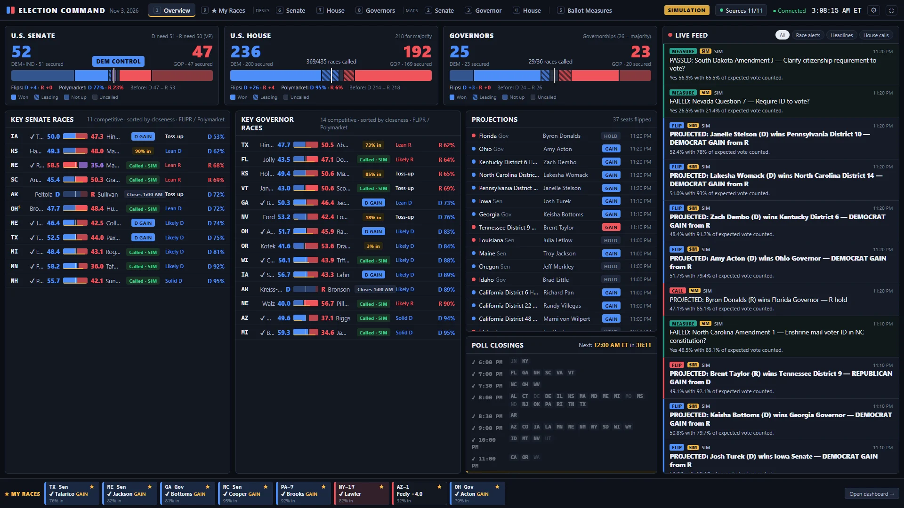

<sub>All screenshots show the built-in simulator replaying an election night over the real 2026 candidates, forecasts and poll-closing schedule. They are not real results.</sub>

---

Election nights usually mean a dozen open tabs: one site for the AP count, another for forecasts, prediction markets in a third, Wikipedia for who held the seat, and news everywhere else. Election Command puts all of it on one screen.

One small server pulls in:

- live results from the same feeds that power the NYT and CNN results pages;
- the FLIPR (Silver Bulletin) and Cook ratings;
- live Polymarket odds for every race;
- a stream of headlines, with a filter for election-day trouble: lawsuits, polls kept open late, broken machines, ballot shortages, long lines.

It lays them out for wall displays: one topic per screen, nothing to reload, every window in sync. Open a browser window on each monitor, pick a view, and leave it.

## A tour

### The maps

Senate, Governor and House maps you can color four ways:

- **Results:** who's leading or has won.
- **Polymarket:** the odds.
- **FLIPR:** the forecast, with Cook as fallback.
- **Current:** who held the seat going in.

The balance-of-power tracker in the corner follows along, tallying seats the way the chosen view sees them. Under Results, the big numbers are seats actually **secured** (called races plus seats not up), with the **expected** total (secured plus races each side currently leads) underneath. Under the other three it counts seats favored or held. Hover any state for the race card: candidates, incumbency, vote counts, expected vote counted, forecasts, market odds. Click to pin it, then open the county results.

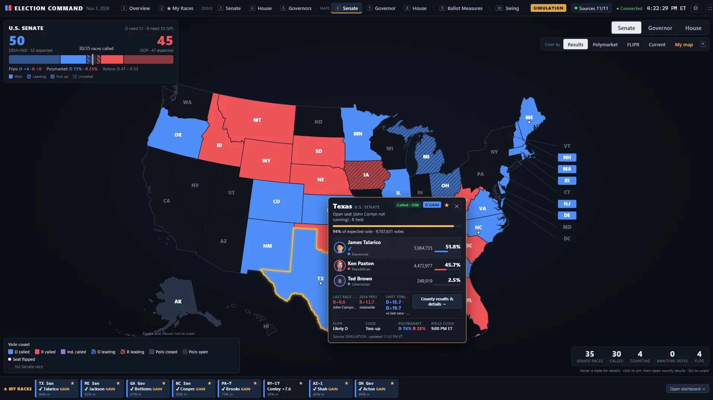

The House map draws all **435 districts from the Census Bureau's 2026 boundaries**, so it reflects the districts redrawn since 2024 in ten states, including the mid-decade redraws in Texas, California, Missouri, North Carolina, Ohio and Utah. Double-click a state to zoom in with district numbers, scroll to zoom further, and hover or click individual districts.

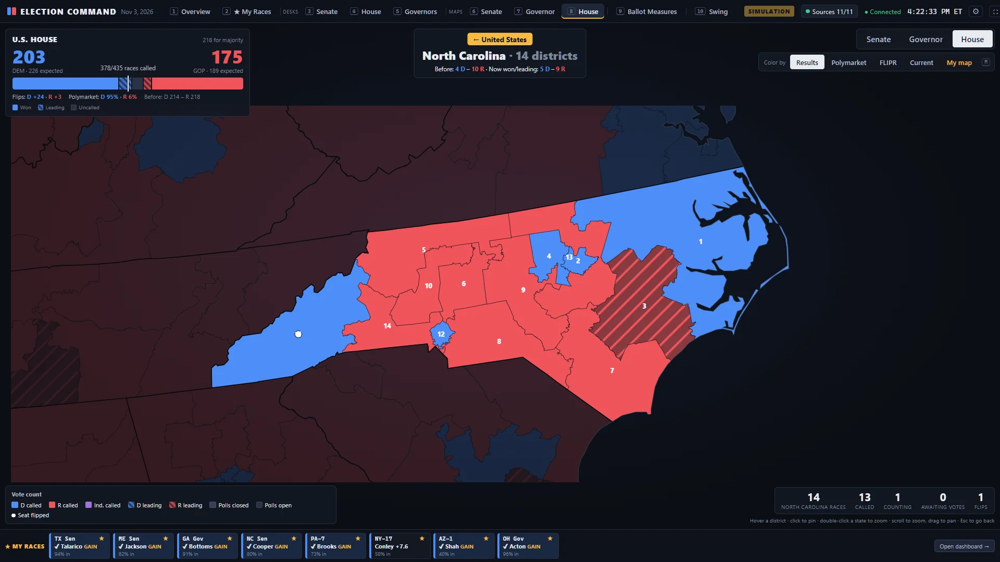

### Every race, county by county

Click any race to open its drill-down. You get:

- the seat's previous result and the 2024 presidential margin, with tonight's shift from each;
- a county map you can switch between current margin, the shift from the baseline, % counted, and the baseline itself. For Senate and governor races the baseline is the same seat's previous race, county by county (Kentucky's Senate race against 2020, Georgia's against its 2021 runoff); House races use the 2024 presidential margin. Connecticut draws its nine planning regions and Alaska its 40 house districts, the units they report by;
- **where the outstanding vote is**, ranked by NYT's expected-vote estimates against each county's 2024 lean, so you can see whether the trailing candidate still has a path;
- the counties moving furthest from 2024;
- a sortable table of every county.

House races show the counties inside the district, clipped to its shape.

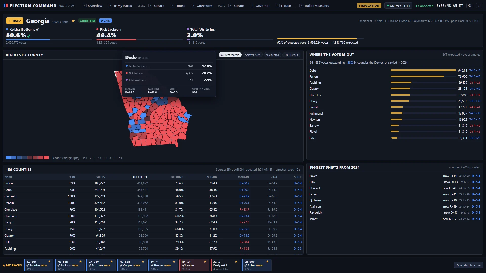

### A desk for each chamber

The Senate, House and Governors each get a full-screen desk with:

- the path to a majority: how many of the remaining races each party still needs;
- a seats-over-the-night timeline of seats actually secured (called races plus seats not up);
- races to watch: the closest counts, upsets against the betting favorite, and toss-ups;
- every seat changing hands;
- a sortable, filterable table of every race.

Each desk also has visuals that fit its chamber:

- **Senate:** a seat ladder ordered from safest D to safest R, with the race that delivers the 51st seat highlighted.
- **House:** a 435-seat hemicycle, the national popular vote, and how each state's delegation is shifting.
- **Governors:** a tile map, plus a chart comparing the Senate and Governor margins in states that vote on both.

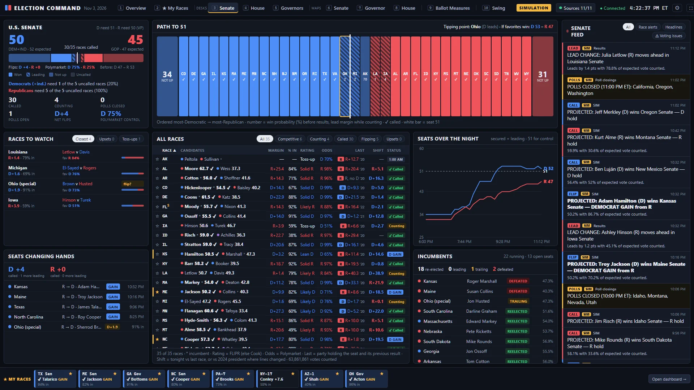

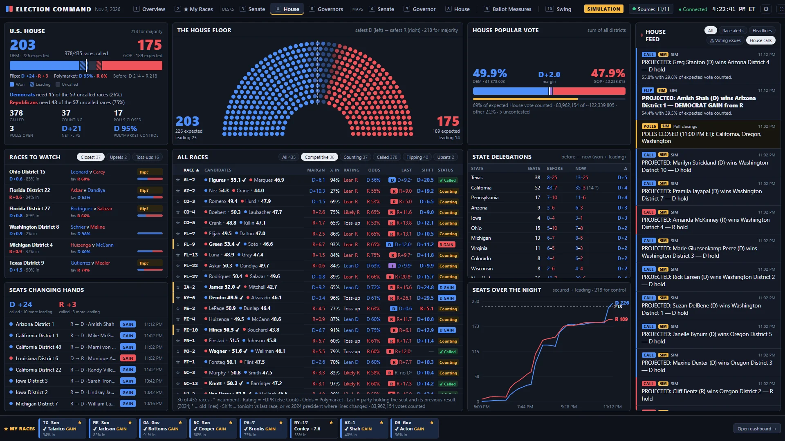

### Ballot measures

Every statewide measure on the November 3 ballot, about 145 in 39 states, more than 90 of them constitutional amendments. Each card shows the measure's official number and its Ballotpedia name, and links to its Ballotpedia page (or Wikipedia, where Ballotpedia has none). It also shows the Yes/No count against the threshold the measure actually needs: Florida amendments need 60%, Colorado's 55%. You can filter by topic, state, status or type.

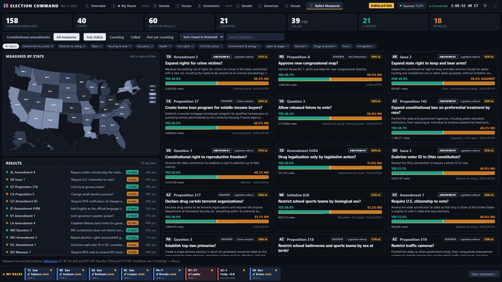

### Swing: tonight against 2022 and 2024

A tenth view compares tonight with the last midterm and the last presidential election:

- the national House vote against the 2024 presidential and House votes and the 2022 midterm;
- a **like-for-like shift**: each district against its own 2024 presidential margin *inside its 2026 lines*, so partial counts don't skew it;
- a scatter of races, before against tonight, and a state map of the shift, each switchable between House, Senate and Governor, and between the 2024 presidential margin and the seat's previous result;
- every race in a sortable table against the previous result for the same seat (House, Senate or Governor);
- Democratic House seats gained or lost: net seats flipped in called races, with the total including current leads underneath;
- the president's party's midterm record since 1994, with tonight's seat change and swing alongside, and the closest historical match.

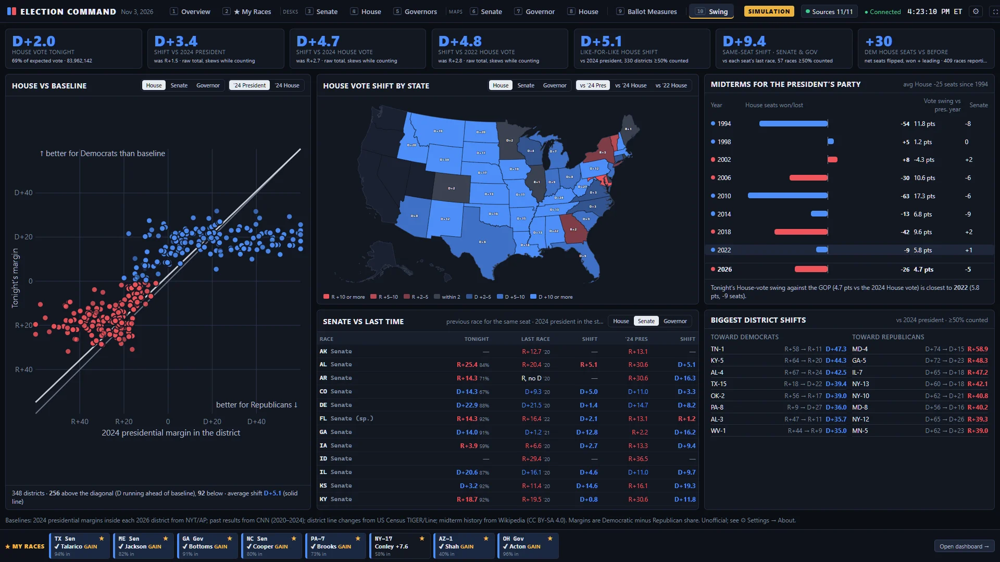

Every race card, desk table and drill-down also shows the seat's previous result: the 2024 House race (flagged when the district was redrawn), the seat's last Senate race (matched by seat class, so Georgia uses its 2021 runoff and Nebraska its 2024 special), or the last governor's race, plus the 2024 presidential margin.

### Your races, and alerts that get your attention

Star (☆) any race. It's pinned to a bar at the bottom of every screen and gets its own card on the **My Races** dashboard, alongside a feed of calls and headlines about its candidates.

When a key race is called, a seat flips, one of your races is decided, or a chamber is clinched, a **breaking banner** appears on every window. You can add an optional chime.

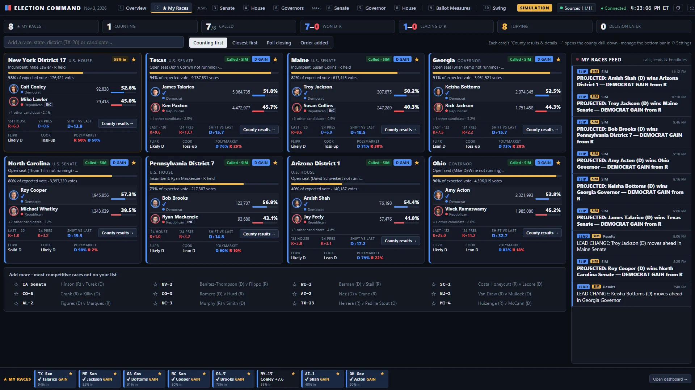

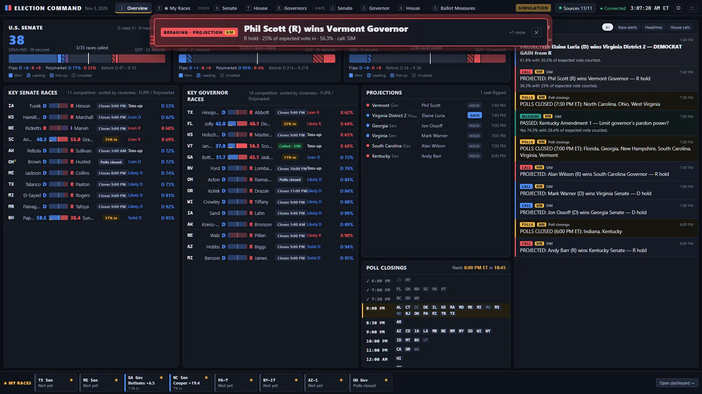

### Build your own map

Every map has a **My map** mode. Start from the forecast, the market odds, the current results or a blank map. Click states or districts to paint your own ratings and watch the seat count change, then copy a link to share it. Your map stays in your browser.

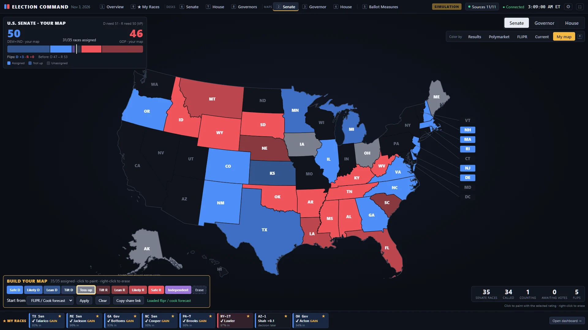

### Also included

- **Kiosk mode:** a window rotates through the views you choose after a minute idle, and pauses the moment you touch it. Turn it on for the one monitor you want cycling.
- **"Decision expected later"** for ranked-choice races without a majority (Alaska; Maine's federal races), likely Georgia runoffs, true toss-ups, and states that count for days.
- **A private simulator** for rehearsing before polls close. It replays the night over the real candidate list in a separate copy of the data, visible only to the admin, and can be paused at any moment.

## Run it

You need Docker and Docker Compose.

```bash
git clone https://github.com/tecknohow/Election_Command.git
cd Election_Command
cp .env.example .env            # set ADMIN_TOKEN: openssl rand -hex 24
docker compose up -d --build
```

Open **http://localhost:8080**, once per monitor. The app works immediately; the admin token is only for the simulator.

### Views & shortcuts

| Key | View |
|---|---|
| `1` | Overview |
| `2` | My Races |
| `3` / `4` / `5` | Senate / House / Governors desk |
| `6` / `7` / `8` | Senate / Governor / House map |
| `9` | Ballot measures |
| `0` | Swing (view 10) |
| `M` / `Shift+M` | Cycle map color mode |
| `Esc` | Unpin a card / leave a zoomed state / close menus |
| `F` | Fullscreen |

Map settings live in the URL (e.g. `/map/house?fill=market&state=TX`), so each monitor can be bookmarked to its own view. Each window also remembers the color mode you last used on each map, so leaving and coming back restores it. Add `?kiosk=1` to make a window rotate.

The **⚙ Settings** menu (top right) controls:

- the alert banner (on by default) and sound (off by default; browsers allow it after your first click or keypress on the page);
- kiosk mode for that window (off by default);
- the My races bar (on by default);
- admin sign-in.

### Rehearsing with the simulator

Sign in under **⚙ Settings → Admin**, then open **Data sources & simulator** and start a simulation at up to 300× speed. **❚❚ Pause** (in the controls, or on the simulation banner) freezes simulated time so you can look around; Resume picks up where it stopped. Only your admin windows that switch to the simulation see it; anyone else using the site keeps seeing live data. `SIM_ALLOWED=false` removes the simulator entirely.

## Where the data comes from

| Data | Source |
|---|---|
| Results, AP race calls, expected vote, county results | NYT results feeds (primary); CNN results feeds (automatic failover and early calls) |
| Forecasts | Silver Bulletin's FLIPR ratings, with Cook as fallback (via Wikipedia's prediction tables) |
| Who held each seat | Wikipedia election tables |
| Prediction markets | Polymarket: every Senate, Governor and House race, plus chamber control |
| Ballot measures | Wikipedia's 2026 ballot measures catalog for the list, numbers and descriptions; Ballotpedia for names and links; results from CNN and NYT/AP |
| Previous results | CNN's results files for 2020–2024; 2024 presidential margins inside each 2026 district from NYT/AP; midterm history from Wikipedia |
| House district boundaries | U.S. Census Bureau, TIGER/Line 2026 (120th Congress); CT planning regions and AK house districts from Census cartographic boundary files |
| Headlines | RSS from NYT, NPR, Politico, The Hill, CBS, ABC, NBC, Fox, Axios and Google News, plus a Google News search for election-day problems |

One server polls each source with conditional requests and backoff. Ten people with three monitors each cause no more upstream traffic than one person. Updates reach every window over Server-Sent Events.

## Disclaimer

Election Command is an independent, unofficial project. It is not affiliated with or endorsed by The New York Times, the Associated Press, CNN, Polymarket, Silver Bulletin, The Cook Political Report, Ballotpedia or Wikipedia.

- **Results are not official.** They come from third-party feeds and can be delayed or wrong. Official results come from state and local election officials.
- **Race calls are projections** by AP or CNN.
- **Forecasts are their publishers' opinions.**
- **Polymarket prices are not probabilities or financial advice.**
- **The results feeds are undocumented.** They're the public JSON files behind the NYT and CNN results pages, may change without notice, and are used here for personal, non-commercial viewing.

[NOTICE.md](NOTICE.md) has the full disclaimer, data-source terms, Wikipedia (CC BY-SA 4.0) and Census attributions, and open-source licenses. The same information is in the app under **⚙ Settings → About**.

[docs/ARCHITECTURE.md](docs/ARCHITECTURE.md) covers the design: merge and failover rules, rate limits, how past results and swings are computed, the simulator, and the security model for public deployments.

## Configuration

All settings are environment variables, usually set in `.env`.

| Env var | Default | Purpose |
|---|---|---|
| `ADMIN_TOKEN` | *(unset)* | Admin sign-in secret (16+ chars). Unset disables admin features and the simulator |
| `ADMIN_SESSION_DAYS` | `7` | Admin cookie lifetime |
| `SIM_ALLOWED` | `true` | Allow the admin-only, isolated simulator |
| `SIM_SPEED` | `60` | Default simulator speed multiplier |
| `PORT` | `8080` | HTTP port inside the container |
| `EC_PORT` / `EC_BIND` | `8080` / `127.0.0.1` | Host port and interface (docker-compose). Use `EC_BIND=0.0.0.0` for LAN monitors |
| `TRUST_PROXY` | *(off)* | `1` behind Caddy, `2` behind Cloudflare + Caddy; rate limits then use real client IPs |
| `HSTS` | `false` | Send Strict-Transport-Security when served over HTTPS |
| `NYT_INTERVAL_S` / `NYT_HOUSE_INTERVAL_S` / `NYT_COUNTY_INTERVAL_S` | `20` / `45` / `45` | NYT polling during the election-night window |
| `CNN_INTERVAL_S` / `POLYMARKET_INTERVAL_S` / `NEWS_INTERVAL_S` | `30` / `30` / `90` | Other polling intervals during the election-night window |
| `HOT_START` / `HOT_END` | `2026-11-03T20:00Z` / `2026-11-05T12:00Z` | Fast-polling window; slower cadence outside it |
| `STALE_AFTER_S` | `180` | Fail over from NYT to CNN after this much staleness (or after two missed NYT polls, whichever is longer) |
| `ENABLE_NYT`, `ENABLE_CNN`, `ENABLE_POLYMARKET`, `ENABLE_WIKIPEDIA`, `ENABLE_NEWS` | `true` | Toggle individual sources |
| `NEWS_FEEDS` | built-in list | `Name\|url\|filter;…` (filter=1 applies the election keyword filter; filter=issues keeps only election-day trouble stories) |
| `MAX_STREAMS` / `MAX_STREAMS_PER_IP` | `150` / `16` | Live-connection caps |
| `API_RATE_PER_MIN` | `120` | REST requests per IP per minute |

State persists in the Docker volume `ec_data`. Back it up with `docker compose cp election-command:/data/state.json ./state-backup.json`.

## Development

```bash
npm install
npm run dev:server        # API on :8080 (tsx watch)
npm run dev:web           # Vite on :5173, proxies /api to :8080
npm run typecheck
npm run build:districts   # regenerate House districts from Census TIGER/Line (~45 MB download)
npm run build:units       # regenerate CT planning-region and AK house-district shapes
npm run build:history     # regenerate shared/src/history.json (past results, redrawn districts, midterms)
                          # and web/public/baselines/county-history.json (county results of each seat's last race)
```

The stack is TypeScript throughout: Fastify on the server; React, Vite, Zustand and d3-geo in the browser.

### API

- `GET /api/state`: full snapshot (races, chambers, measures, news, sources, poll closings, seat history)
- `GET /api/stream`: gzip Server-Sent Events; race and measure updates are field-level patches
- `GET /api/races/:id`: one race, e.g. `TX-S`, `OH-G`, `CA-H-22`
- `GET /api/races/:id/counties`: county-level results for one race
- `GET /api/measures`: all ballot measures
- `GET /api/health`: liveness (per-source detail for admins)
- `GET /api/admin/me`, `POST /api/admin/login|logout`: admin session (HttpOnly, SameSite=Strict cookie)
- `POST /api/admin/sim/start|stop|speed|pause`: simulator control (`pause` takes `{ "paused": true|false }`). Requires an admin session, a same-origin request, the `X-EC-Request: 1` header and a JSON body

## License

The source code is MIT-licensed; see [LICENSE](LICENSE). Data and bundled map assets belong to their sources under their own terms; see [NOTICE.md](NOTICE.md).
